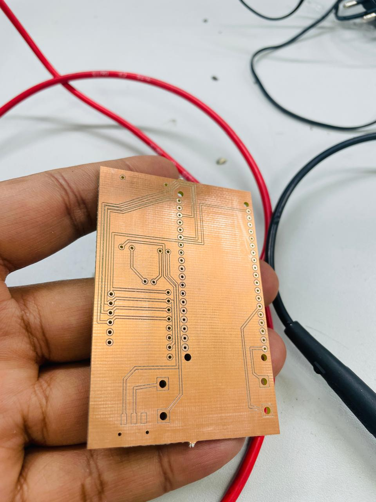
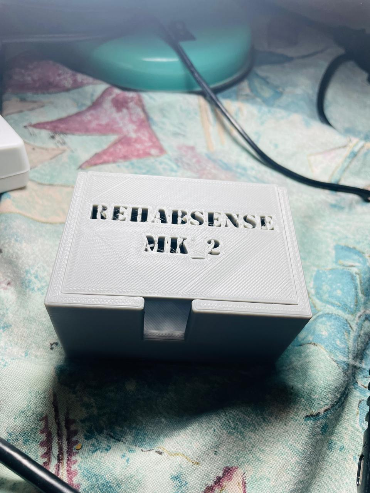
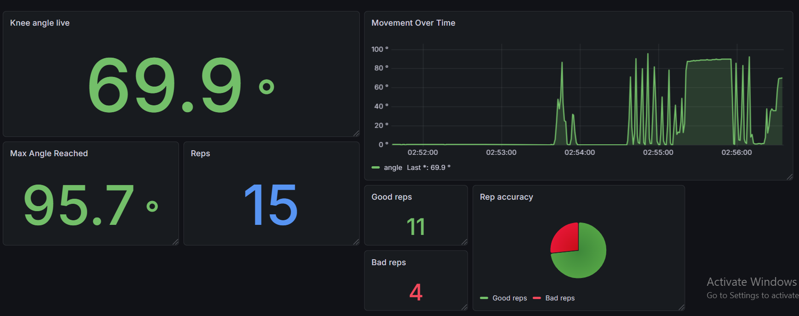

# RehabSense — Smart Wearable Knee Rehabilitation Tracker

A wearable rehabilitation monitoring prototype that estimates knee joint angle, tracks exercise repetitions, and classifies movement quality using IMU sensors, an ESP32, and an IoT-based monitoring dashboard.

## Overview

RehabSense is a low-cost wearable system developed to explore real-time monitoring of knee rehabilitation exercises. It uses two MPU6050 inertial measurement units (IMUs), positioned on the thigh and shin, to estimate knee angle and monitor exercise movements.

The system combines embedded hardware, wireless communication, a Python backend, time-series data storage, and dashboard visualisation to demonstrate a connected approach to rehabilitation monitoring.

**Project type:** Biomedical engineering · Embedded systems · Internet of Things (IoT)

## The Problem

Home-based knee rehabilitation requires patients to perform exercises consistently and with appropriate movement. However, clinicians may have limited access to objective movement data between appointments, while conventional assessment tools do not provide continuous monitoring.

RehabSense explores how an affordable wearable sensing system could help capture movement data and make exercise monitoring more accessible.

## Key Features

- **Knee-angle estimation:** Uses two IMUs mounted on the thigh and shin.
- **Range-of-motion monitoring:** Tracks estimated knee movement during exercises.
- **Repetition counting:** Detects and counts exercise repetitions.
- **Movement-quality classification:** Classifies repetitions as good or bad based on the implemented logic.
- **Wireless communication:** Supports Bluetooth Low Energy (BLE) and MQTT-based data transfer.
- **Data visualisation:** Displays movement data using Grafana and InfluxDB.
- **Local data logging:** Supports CSV backup logging.

## System Architecture

```text
MPU6050 — Thigh
       |
       | I²C
       |
MPU6050 — Shin
       |
       v
     ESP32
       |
       +---- BLE ----> Local BLE feedback
       |
       +---- Wi-Fi / MQTT ----> MQTT Broker
                                      |
                                      v
                                Python Backend
                                      |
                                      v
                                   InfluxDB
                                      |
                                      v
                                   Grafana
```

The ESP32 collects sensor data and supports the system's local and wireless monitoring functions. The Python backend processes incoming data and supports storage and visualisation through InfluxDB and Grafana.

## Knee-Angle Estimation

The system estimates the knee joint angle using the relative orientation of the thigh and shin sensors.

A simplified relationship is:

`Knee angle ≈ Thigh pitch − Shin pitch`

The actual angle calculation depends on sensor orientation, calibration, and the implemented processing logic. The estimate should therefore be interpreted as a prototype measurement rather than a clinically validated joint-angle measurement.

## Hardware

### Main unit — thigh strap

- ESP32 microcontroller
- MPU6050 IMU
- Li-ion battery (2500–3000 mAh)
- TP4056 charging module
- MT3608 boost converter
- Power switch
- Custom 3D-printed enclosure

### Secondary unit — shin strap

- MPU6050 IMU
- Wired I²C connection
- Compact enclosure

## Software and Technologies

| Component | Technology |
|---|---|
| Microcontroller firmware | C++ / Arduino IDE |
| Motion sensing | MPU6050 IMUs |
| Wireless communication | BLE, Wi-Fi, MQTT |
| Backend | Python |
| MQTT broker | HiveMQ / configured broker |
| Time-series database | InfluxDB |
| Dashboard | Grafana |
| Hardware prototyping | PCB design and 3D-printed enclosure |

## Prototype and Implementation

The project combines wearable sensor integration, embedded programming, PCB development, enclosure design, backend processing, and dashboard visualisation.

### Hardware and PCB




### Monitoring dashboard



## Setup

### 1. ESP32 firmware

1. Open the firmware file `BLE_MQTT_graphana_code.ino` in Arduino IDE.
2. Select the appropriate ESP32 board.
3. Configure the required network and communication settings in the firmware.
4. Connect the hardware and upload the code.

### 2. Python backend

Install the required Python packages:

```bash
pip install -r requirements.txt
```

Run the backend:

```bash
python backend.py
```

### 3. InfluxDB

Configure the InfluxDB URL, organisation, bucket, and authentication token. The intended bucket name is `rehab_data`.

Keep credentials and tokens private. Do not commit real secrets to the repository.

### 4. Grafana

Configure InfluxDB as a data source and create dashboard panels for the available rehabilitation measurements.

**Note:** Exact configuration requirements depend on the versions and settings used in your environment.

## Results

The prototype was developed to demonstrate:

- Real-time knee-angle visualisation
- Exercise repetition tracking
- Movement-quality classification
- Wireless data communication
- Dashboard-based monitoring

These are prototype capabilities; clinical accuracy and improvements in patient recovery would require further testing and validation.

## Future Work

- Mobile application integration
- More robust movement analysis
- Cloud deployment
- Remote clinician monitoring
- Further evaluation of angle-estimation accuracy and movement classification

## Author

**Vimukthi Mahela Ranasinghe**

Biomedical Engineering | University of Oulu

Developed as a biomedical engineering project exploring wearable sensing and connected rehabilitation technology.
